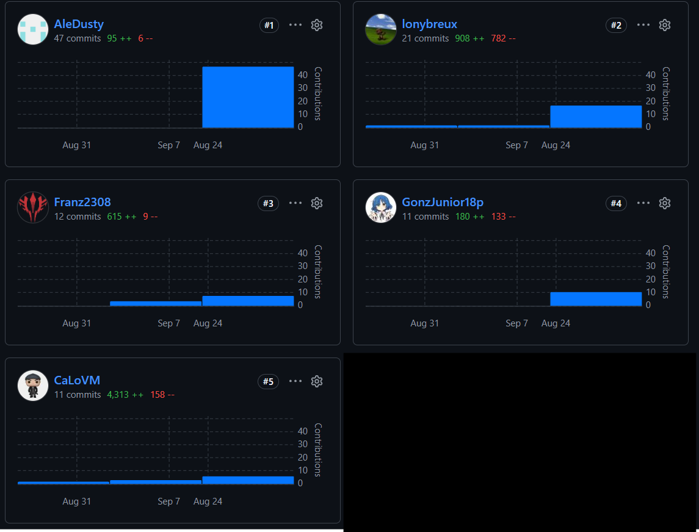
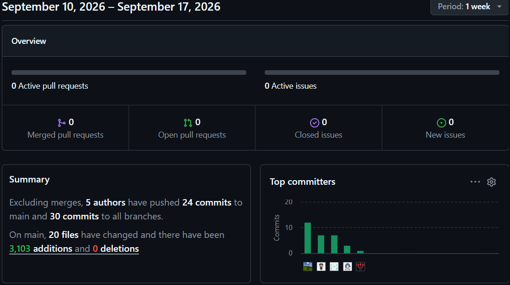
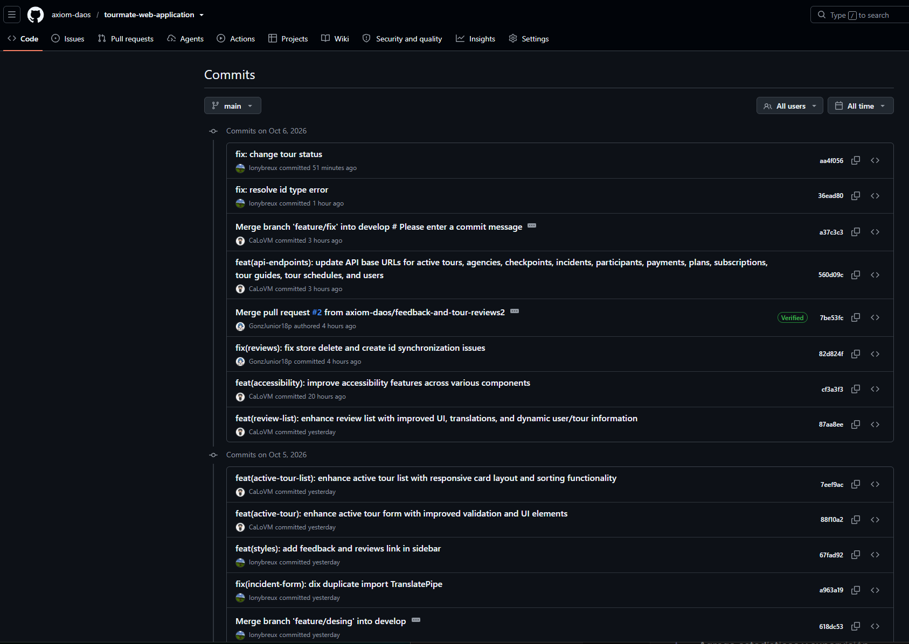

# Project Report Collaboration Insights

- URL del repositorio para el reporte del proyecto: https://github.com/axiom-daos/tourmate-report
- URL del repositorio para la Landing Page: https://github.com/axiom-daos/tourmate-landing
- URL del repositorio para la Web Application (Frontend Angular): https://github.com/axiom-daos/tourmate-web-application
- URL del repositorio para la Web Platform (Backend Spring Boot): https://github.com/axiom-daos/tourmate-platform

---

### AV1 (Sprint 1 - Conceptualización, Landing Page y Documentación Inicial)

Para el desarrollo del informe perteneciente a la entrega AV1, se dividió la implementación de secciones de la siguiente forma para cada integrante del equipo:

| Integrante | Tareas Asignadas |
| :--- | :--- |
| Quispe Palomino, Tony Jhunior | Desarrollo del Capítulo I y del Capítulo II en formato markdown. |
| Huingo Tello, Frank Anthony | Desarrollo del Capítulo III, parte del capítulo IV en formato markdown. |
| Molina Vasquez, Manuel Alejandro | Desarrollo del Capítulo IV enfocado en desarrollo de UX/UI Design. |
| Carrillo Acho, Matias Renato | Desarrollo del Capítulo IV enfocado en system design, así como colaboración en el capítulo V del documento en formato markdown. |
| Verastigue Martinez, Giancarlo Jose | Desarrollo del Capítulo V, despliegue de Landing Page. |

El trabajo se desarrolló mediante commits continuos en el repositorio de la organización, asegurando trazabilidad y colaboración activa del equipo.

*Report Insights AV1*

---

### TB1 (Sprint 2 - Frontend Web Application, Servicios Mock y Arquitectura de Dominio)

Para el informe de la entrega TB1, se distribuyeron las secciones correspondientes al diseño de la aplicación web, arquitectura DDD y especificación de servicios:

| Integrante | Tareas Asignadas |
| :--- | :--- |
| Verastigue Martinez, Giancarlo Jose | Documentación del Sprint 2, Landing page (sección planes) y configuración SCM en GitHub. |
| Quispe Palomino, Tony Jhunior | Refinamiento de Product Backlog, Big Picture EventStorming y User Stories del Sprint 2. |
| Huingo Tello, Frank Anthony | Actualización de arquitectura de software, diagramas de contexto y sección Student Outcome TB1. |
| Molina Vasquez, Manuel Alejandro | Documentación del modelo de incidentes, protocolos de emergencia y archivos de traducción i18n. |
| Carrillo Acho, Matias Renato | Documentación de interfaces de usuario, mockups y contratos para tours en Angular. |

*Report Insights TB1*

---

### TB2 / AV2 (Sprint 3 - Backend RESTful, Base de Datos PostgreSQL, OpenAPI y Validación)

Para el avance del Final Project Report correspondiente a la entrega TB2 / AV2, la elaboración de las secciones del informe se organizó de forma multidisciplinaria cubriendo los tres frentes tecnológicos y la validación con usuarios:

| Integrante | Tareas Asignadas |
| :--- | :--- |
| Verastigue Martinez, Giancarlo Jose | Bounded Context Active Tours & Profiles, diagramas de clases Lucidchart, evaluación heurística y Sprint Review. |
| Quispe Palomino, Tony Jhunior | Bounded Context Feedback & Reviews, controladores RESTful, integración multimedia en Landing Page y entrevistas de validación. |
| Huingo Tello, Frank Anthony | Bounded Context Subscriptions & Payments con CQRS, video About-the-Product, Student Outcome AV2 y verificación integral del reporte. |
| Molina Vasquez, Manuel Alejandro | Bounded Context Safety & Incidents, endpoints REST, métricas de calidad y registro de entrevistas. |
| Carrillo Acho, Matias Renato | Bounded Context Tour Management, Docker Compose (compose.yaml), Sprint Review 3 y compilación del informe final. |

*Report Insights TB2 / AV2*

---
