## 4.7. Software Object-Oriented Design

El diseño orientado a objetos de TourMate se fundamenta en los principios de **Domain-Driven Design (DDD)** y **Clean Architecture**, asegurando que el modelo de clases refleje con fidelidad las entidades, agregados e invariantes del negocio identificados durante la fase de análisis de dominio. La arquitectura desacopla la lógica del sistema en contextos delimitados (*Bounded Contexts*) independientes, los cuales interactúan entre sí mediante contratos estrictos, Value Objects inmutables e interfaces de comunicación limpias.

### 4.7.1. Class Diagrams

A continuación, se presenta la arquitectura de clases del ecosistema TourMate, iniciando con el diagrama general del sistema y profundizando posteriormente en cada uno de los *Bounded Contexts* que lo integran:

#### Diagrama de Clases General de TourMate

Este diagrama proporciona una visión integradora y holística de la arquitectura de clases del sistema, evidenciando las relaciones estructurales, asociaciones y dependencias entre los distintos contextos delimitados:

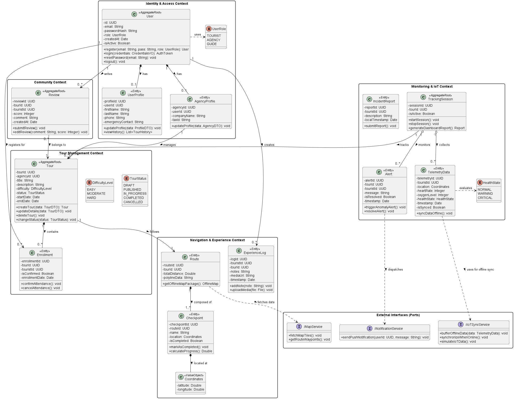

---

#### 4.7.1.1. Bounded Context: Shared Kernel

Agrupa los Value Objects transversales reutilizados a lo largo de todo el dominio de la aplicación para garantizar consistencia semántica, tipado fuerte y prevenir el uso de tipos primitivos dispersos (*Primitive Obsession*):
- **Value Objects:** `Money` (encapsula monto decimal y moneda con operaciones aritméticas seguras), `Currency` (código ISO normalizado), `Coordinates` (latitud y longitud geográficas con métodos de cálculo de distancia haversine), e identificadores universales únicos (*UUID-based VOs*): `ActiveTourId`, `TourId`, `TourScheduleId`, `AgencyId` y `UserId`.

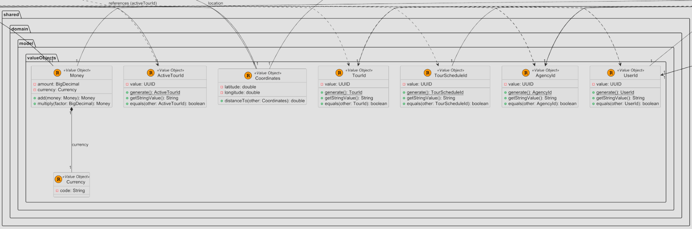

---

#### 4.7.1.2. Bounded Context: Identity and Access Management

Gestiona el registro, autenticación, control de sesiones y ciclo de vida de las cuentas de usuario y perfiles organizacionales de la plataforma:
- **Aggregate Root:** `User` (administra email, hash de credenciales, estado de activación de cuenta y rol asignado).
- **Aggregates y Entidades:** `TourGuide` (perfil profesional del guía turístico, idiomas y acreditaciones) y `Agency` (perfil empresarial, razón social, RUC/Tax ID y datos de contacto comercial).
- **Value Objects:** `EmailAddress`, `Password`, `PersonName`, `PhoneNumber`, `ContactInfo`, `BusinessName`.
- **Enumeraciones:** `Role` (`ADMIN`, `TOURIST`, `AGENCY_OWNER`, `TOUR_GUIDE`).

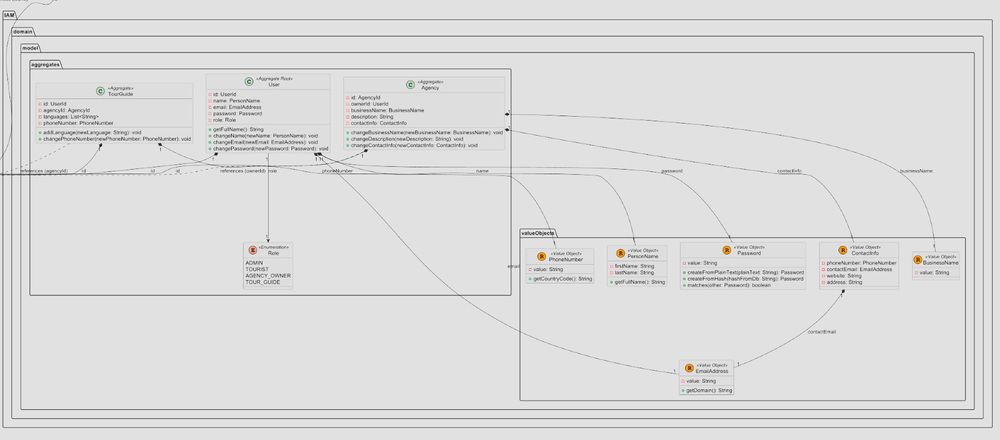

El siguiente diagrama de clases muestra el modelo interno, sin relaciones con otros *bounded contexts*.

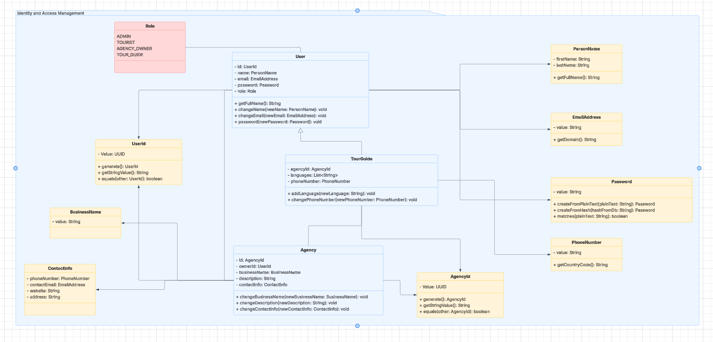

---

#### 4.7.1.3. Bounded Context: Tour Management

Controla la creación, configuración, publicación y administración del catálogo de experiencias turísticas ofrecidas por las agencias:
- **Aggregate Root:** `Tour` (encapsula título, descripción, nivel de dificultad, precio base, estado de visibilidad y la colección ordenada de paradas turísticas).
- **Aggregates y Entidades:** `TourSchedule` (representa una fecha y hora programada de expedición, gestionando capacidad máxima de cupos y lista de turistas asignados), `Checkpoint` (parada intermedia con nombre, coordenadas de geolocalización y orden secuencial) y `Participant` (turista asignado con fecha de inscripción y estado).
- **Value Objects:** `TourId`, `CheckpointId`, `TourDetails`, `DepartureDateTime`.
- **Enumeraciones:** `TourStatus` (`DRAFT`, `PUBLISHED`, `UNAVAILABLE`) y `TourScheduleStatus` (`OPENED`, `CLOSED`).

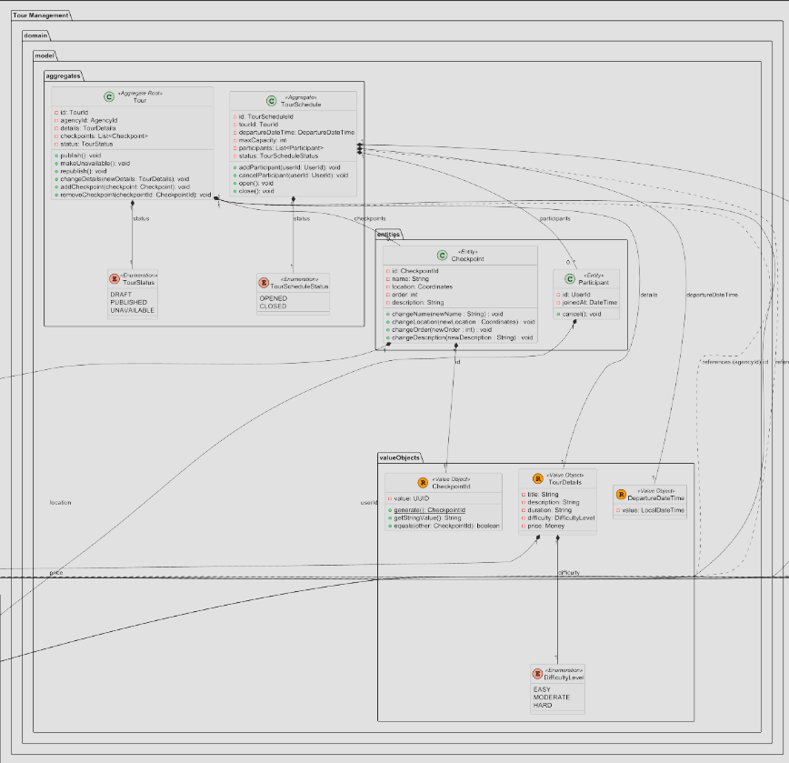

El siguiente diagrama de clases muestra el modelo interno, sin relaciones con otros *bounded contexts*.

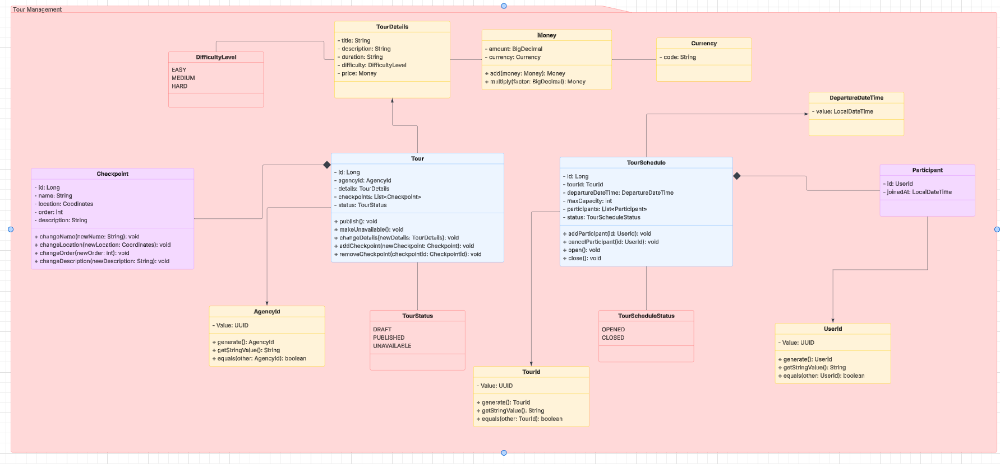

---

#### 4.7.1.4. Bounded Context: Tour Monitoring

Gestiona la supervisión en tiempo real de las expediciones en curso, calculando el progreso del recorrido, verificando la presencia del grupo y registrando telemetría operativa:
- **Aggregate Root:** `ActiveTour` (coordina la expedición activa en campo, registrando el guía asignado, tiempos de inicio/finalización, coordenadas actuales y estado operacional).
- **Operaciones de Dominio:** `startTour()`, `updateLocation()`, `completeCheckpoint()`, `finishTour()`.
- **Interacciones:** Se comunica con el contexto de navegación para recibir coordenadas GPS y con el contexto de seguridad para alertar anomalías, desvíos o retrasos críticos durante el recorrido.

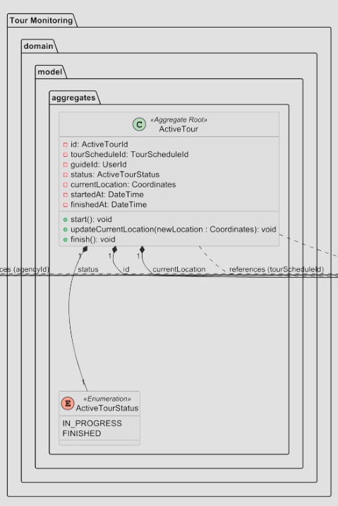

El siguiente diagrama de clases muestra el modelo interno, sin relaciones con otros *bounded contexts*.

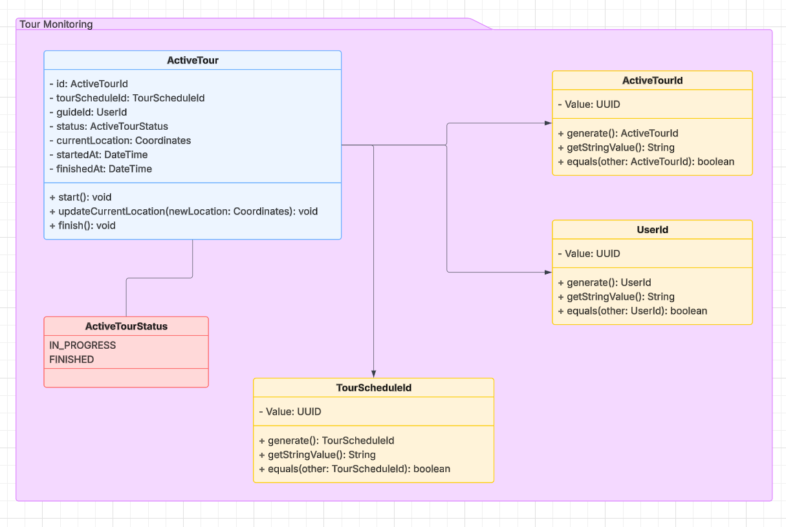

---

#### 4.7.1.5. Bounded Context: Safety and Incident Management

Supervisa los signos vitales, alertas biométricas y la documentación formal de incidentes o emergencias médicas y mecánicas durante las expediciones:
- **Aggregate Root:** `Incident` (registra el reporte formal de una eventualidad, usuario afectado, expedición asociada, coordenadas geográficas, fecha de ocurrencia y estado de resolución).
- **Value Objects:** `IncidentId`, `Coordinates`.
- **Enumeraciones:** `IncidentStatus` (`REPORTED`, `RESOLVED`).
- **Lógica de Negocio:** Permite la detección automática de umbrales biométricos anómalos y el despacho inmediato de notificaciones de emergencia tanto a la agencia como a brigadas de socorro.

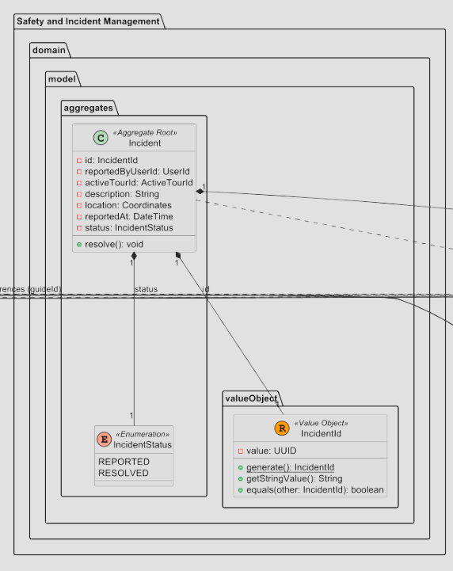

El siguiente diagrama de clases muestra el modelo interno, sin relaciones con otros *bounded contexts*.

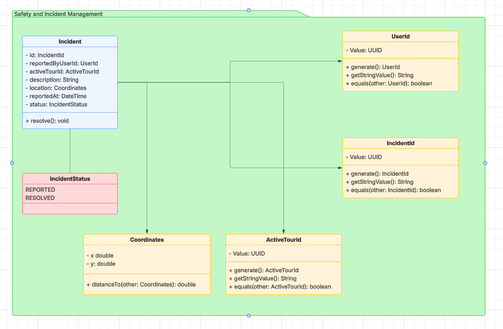

---

#### 4.7.1.6. Bounded Context: Feedback and Tour Reviews

Administra las valoraciones cuantitativas y reseñas cualitativas generadas por los turistas al finalizar un tour, fortaleciendo la reputación del servicio:
- **Aggregate Root:** `Review` (encapsula el tour calificado, turista autor, puntuación global y fecha de emisión).
- **Entidades asociadas:** `Comment` (texto detallado con validación de contenido y moderación).
- **Value Objects:** `Rating` (valor numérico tipado de 0 a 5 estrellas con validación de rango).

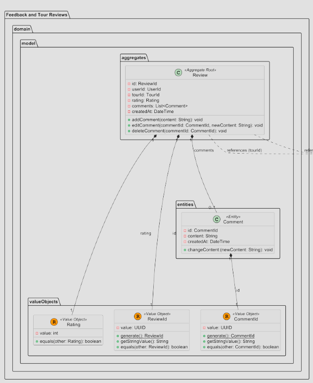

El siguiente diagrama de clases muestra el modelo interno, sin relaciones con otros *bounded contexts*.

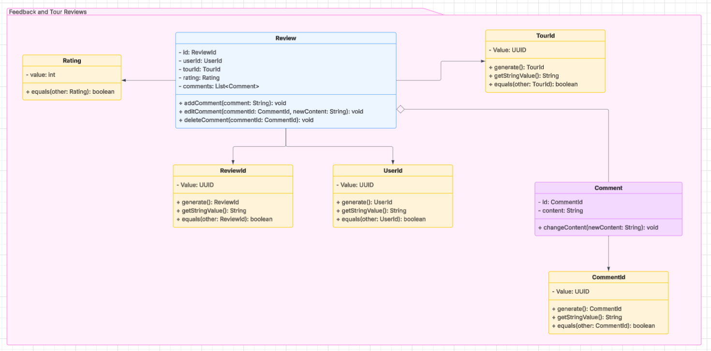

---

#### 4.7.1.7. Bounded Context: Subscriptions and Payment Management

Gestiona los planes comerciales de suscripción y el procesamiento de transacciones financieras para las agencias y usuarios de la plataforma TourMate:
- **Aggregate Roots:** `Subscription` (controla la vigencia del servicio, plan contratado y estado de renovación), `Plan` (define nombre del plan comercial, precio recurrente y características operativas incluidas como `Feature`), y `Payment` (procesa la orden de cobro, monto, pasarela de pago y estado de la transacción).
- **Value Objects:** `SubscriptionId`, `PlanId`, `PaymentId`, `Feature`, `Money`.
- **Enumeraciones:** `SubscriptionStatus` (`ACTIVE`, `CANCELLED`) y `PaymentStatus` (`REQUESTED`, `PROCESSED`, `REJECTED`).

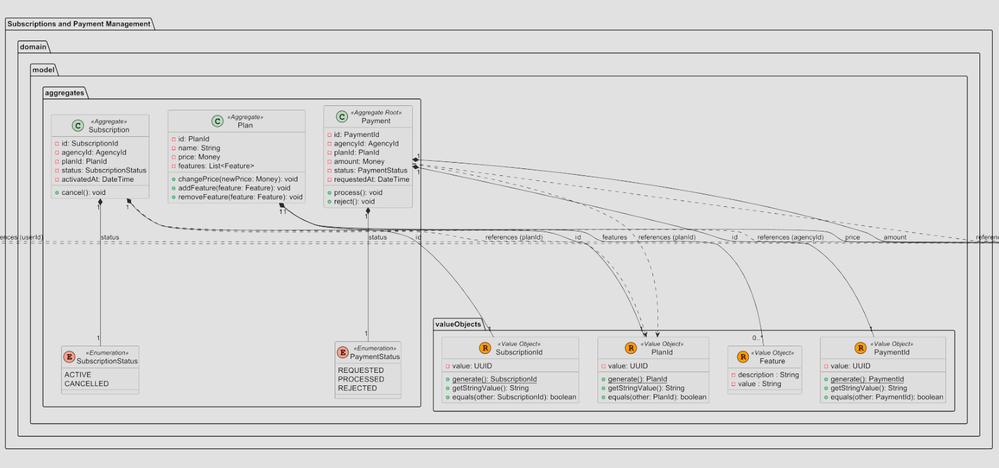

El siguiente diagrama de clases muestra el modelo interno, sin relaciones con otros *bounded contexts*.

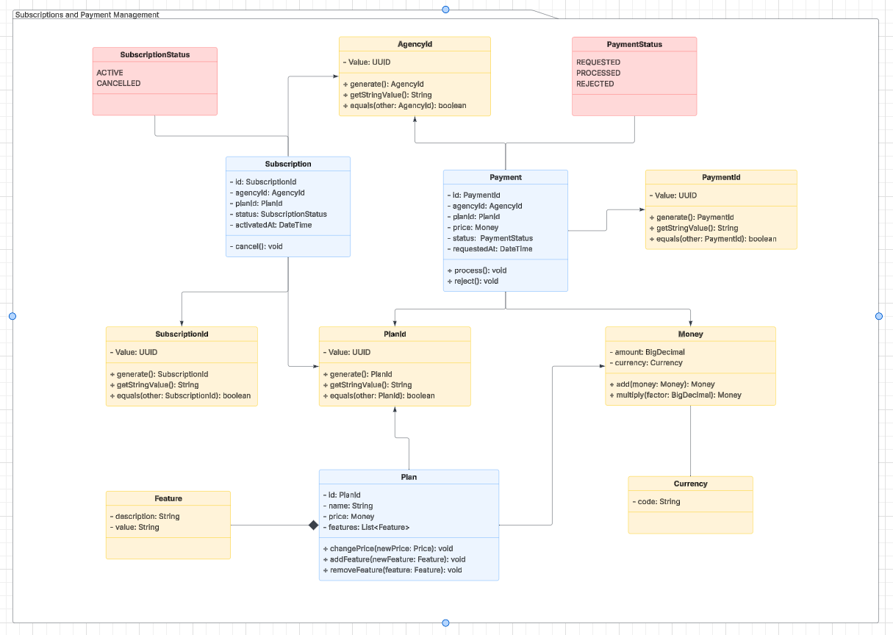