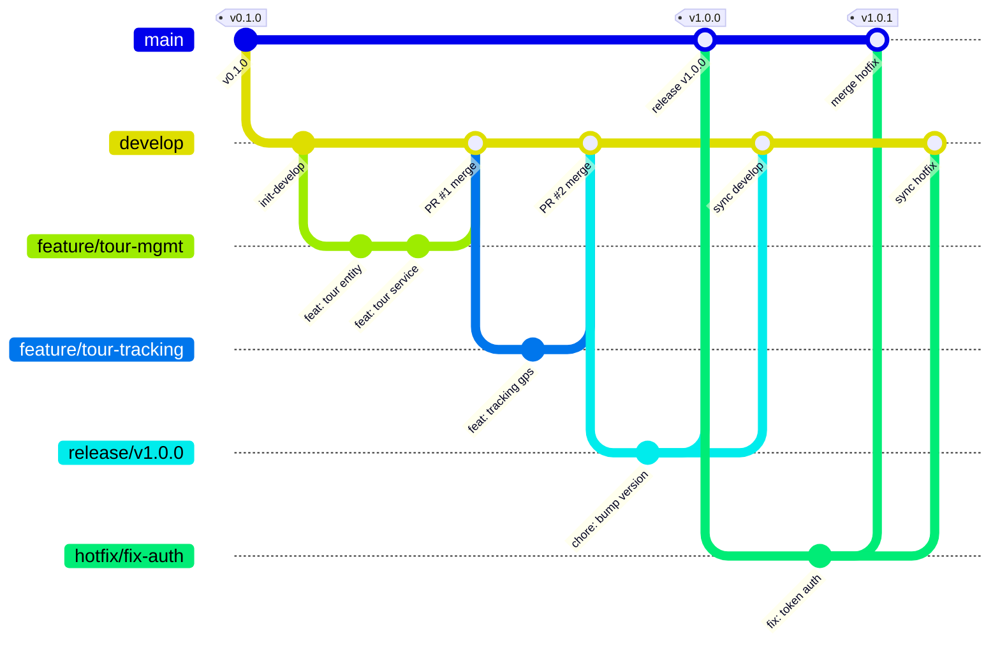

## Capítulo V: Product Implementation, Validation & Deployment
### 5.1. Software Configuration Management
#### 5.1.1. Software Development Environment Configuration
Con el objetivo de garantizar un desarrollo fluido, estandarizado y consistente entre todos los miembros del equipo, se ha definido el siguiente entorno de desarrollo para el ecosistema TourMate:

| Actividad                              | Producto                 | Propósito / Uso                                                                 |
|---------------------------------------|--------------------------|----------------------------------------------------------------------------------|
| Project Management                    | Trello                   | Gestión del Product Backlog, planificación de Sprints y seguimiento de tareas.  |
| Requirements Management               | UXPressia                | Elaboración de artefactos de descubrimiento (User Personas, Empathy Maps, Journey Maps) para la definición de requisitos. |
| UX/UI Design                          | Figma                    | Diseño de la guía de estilo, prototipos de baja fidelidad (wireframes) y alta fidelidad (mockups). |
| User Flows & Wireflows                | LucidChart               | Elaboración de Wireflows y User Flows.                                          |
| Class Diagrams & Data Base Design     | PlantUML                 | Elaboración de diagramas de clases y diseño de base de datos.                   |
| Software Development (Backend)        | IntelliJ IDEA / VS Code  | IDE para el desarrollo de Web Services bajo estilo RESTful utilizando Java 21, Spring Boot 3.x, Spring Data JPA y PostgreSQL. |
| Software Development (Frontend)       | Visual Studio Code       | IDE para el desarrollo de la Web Application SPA con Angular 19, TypeScript, Angular Material y SCSS. |
| Software Development (Landing Page)   | Visual Studio Code       | IDE para el desarrollo de la Landing Page con HTML5, CSS3 y JavaScript vanilla. |
| Version Control                       | GitHub                   | Alojamiento de repositorios y gestión de versiones aplicando GitFlow y Conventional Commits. |
| Continuous Deployment & Hosting       | Firebase Hosting / GitHub Pages | Alojamiento y entrega continua de la aplicación Web Frontend y la Landing Page. |
| Documentation                         | Markdown                 | Documentación del reporte del proyecto.                                         |

#### 5.1.2. Source Code Management

El código fuente del proyecto se gestionará utilizando **Git** como sistema de control de versiones y **GitHub** como plataforma de alojamiento, bajo una organización pública. Se adoptará un enfoque estructurado que favorezca la colaboración, la modularidad y el despliegue continuo mediante repositorios independientes para cada componente del sistema.

- **Report:** [https://github.com/axiom-daos/tourmate-report](https://github.com/axiom-daos/tourmate-report)
- **Landing Page:** [https://github.com/axiom-daos/tourmate-landing](https://github.com/axiom-daos/tourmate-landing)
- **Frontend Web Application:** [https://github.com/axiom-daos/tourmate-web-application](https://github.com/axiom-daos/tourmate-web-application)
- **RESTful Web Services:** [https://github.com/axiom-daos/tourmate-platform](https://github.com/axiom-daos/tourmate-platform)

#### Estrategia de Ramas y Flujo de Colaboración (GitFlow Workflow)

Para asegurar la integridad, trazabilidad y estabilidad del código fuente a lo largo del ciclo de vida del desarrollo, el equipo adopta el modelo **GitFlow** como flujo de trabajo estándar de ramificación (*branching*) y colaboración. Este flujo define reglas estrictas para el aislamiento de funcionalidades, la integración continua y el despliegue seguro a producción:



##### Roles y Ciclo de Vida de las Ramas

1. **Ramas Principales (Permanentes):**
   - **`main`**: Alberga exclusivamente el código en estado de producción. Todo commit en esta rama corresponde a una versión estable, probada y empaquetada, acompañada de un tag semántico (ej. `v1.0.0`). Los desarrolladores tienen prohibido realizar commits directos sobre `main`.
   - **`develop`**: Rama base de integración continua. Refleja el estado consolidado de las funcionalidades desarrolladas para el próximo Sprint o entrega. Todo el trabajo nuevo se desprende de `develop` y se reintegra a ella tras pasar por revisión de código.

2. **Ramas de Soporte (Temporales / Efímeras):**
   - **`feature/[nombre-funcionalidad]`**: Ramas creadas exclusivamente a partir de `develop` para desarrollar una User Story o tarea de ingeniería específica (ej. `feature/US13-tour-assignment`, `feature/subscriptions-and-payment-management`). Al concluirse y superar las pruebas locales, se solicita su fusión hacia `develop` mediante un Pull Request. Una vez fusionada, la rama remota se elimina.
   - **`release/[versión]`**: Ramas destinadas a la estabilización previa a un hito o entrega de Sprint (ej. `release/sprint-3`). Permiten pulir documentación, corregir detalles menores de configuración y preparar los metadatos de versión sin bloquear el trabajo de nuevas features en `develop`. Al finalizar, se fusiona tanto a `main` (creando el tag) como de regreso a `develop`.
   - **`hotfix/[nombre-incidencia]`**: Ramas críticas generadas a partir de `main` para solventar errores severos detectados en producción que no pueden esperar al siguiente ciclo de desarrollo. Una vez solucionado el fallo, se integran inmediatamente a `main` y a `develop`.

##### Políticas de Colaboración y Revisión de Código (Code Review)

- **Pull Requests (PR) Obligatorios:** Ningún miembro del equipo puede fusionar código directamente sobre `develop` o `main`. Todo cambio debe tramitarse mediante un Pull Request en GitHub.
- **Revisión por Pares (Peer Review):** Todo PR requiere al menos una aprobación explícita de un compañero de equipo antes del merge, verificando el cumplimiento de la guía de estilos, la arquitectura DDD/Clean Architecture y la ausencia de deuda técnica.
- **Trazabilidad y Conventional Commits:** Los títulos de los PR y los commits deben referenciar la tarea o User Story correspondiente y adherirse a Conventional Commits.
- **Resolución de Conflictos:** En caso de conflicto de integración, el autor de la rama feature debe actualizar su rama con la última versión de `develop` (`git merge develop` o `git rebase develop`) y resolver los conflictos localmente antes de solicitar la fusión.

#### Convención de Commits (Conventional Commits)

Para mantener un historial claro, consistente y facilitar la generación automática de *changelogs*, todos los commits deberán seguir el estándar de **Conventional Commits**:

#### Tipos permitidos

- **feat**: Nueva funcionalidad  
  (ej. *feat(ordering): add automated order validation policy*)

- **fix**: Corrección de errores  
  (ej. *fix(auth): resolve token expiration on mobile devices*)

- **docs**: Cambios en documentación  
  (ej. *docs(interviews): update stakeholder interview records*)

- **style**: Cambios de formato que no afectan la lógica del código (espacios, indentación, etc.)

#### 5.1.3. Source Code Style Guide & Conventions

Para mantener la legibilidad y calidad del código, todo el equipo aplicará **nomenclatura estrictamente en inglés** para clases, variables, métodos y bases de datos. Además, se adoptan las siguientes guías de estilo oficiales:

- **HTML & CSS:** Se seguirán las directrices de la [HTML Style Guide and Coding Conventions](https://www.w3schools.com/html/html5_syntax.asp) de W3C y la [Google HTML/CSS Style Guide](https://google.github.io/styleguide/htmlcssguide.html).
- **Frontend (Angular / TypeScript):** Se respetará la [Angular Coding Style Guide](https://angular.io/guide/styleguide). Las clases usarán `PascalCase`, variables/métodos `camelCase`, y archivos `kebab-case`. Se utilizará Prettier y ESLint para automatizar el formato.
- **Backend (Spring Boot / Java):** Se aplicará la [Google Java Style Guide](https://google.github.io/styleguide/javaguide.html). La arquitectura se dividirá en capas estrictas (Controllers, Services, Repositories, Entities). Los endpoints RESTful usarán sustantivos en plural (ej. `GET /api/v1/parking-spots`).
- **Requerimientos:** Se emplearán las [Gherkin Conventions](https://specflow.org/gherkin/gherkin-conventions-for-readable-specifications/) para la redacción estructurada de los criterios de aceptación (Given/When/Then).


#### 5.1.4. Software Deployment Configuration

En esta sección se describe la arquitectura y configuración técnica del despliegue de las soluciones cliente de TourMate, detallando los entornos, herramientas y pasos necesarios para compilar y publicar los productos de software a partir de sus respectivos repositorios de código fuente.

El ecosistema cliente de TourMate se compone de dos productos digitales diferenciados:
1. **Landing Page y Documentación del Proyecto:** Alojados en **GitHub Pages** para publicación estática directa desde el repositorio.
2. **Frontend Web Application (Web App):** Desplegado en **Firebase Hosting** (Google Cloud Platform) para soportar el ciclo de vida de una Single Page Application (SPA) con enrutamiento dinámico, distribución global por CDN y certificados SSL automatizados.

---

#### 5.1.4.1. Despliegue de la Landing Page (GitHub Pages)

El despliegue de la Landing Page institucional se gestiona directamente desde su repositorio de control de versiones mediante GitHub Pages:

1. **Configuración del Repositorio:** El código fuente se encuentra alojado en la organización oficial en el repositorio `tourmate-landing`.
2. **Definición de Rama de Despliegue:** Se configura la rama `main` como rama fuente de publicación en la configuración del repositorio (*Settings $\rightarrow$ Pages*).
3. **Estructura de Publicación:** Se selecciona el directorio raíz (`/root`) donde se aloja el archivo `index.html` y los recursos estáticos vinculados con rutas relativas.
4. **Automatización:** Cada nuevo commit confirmado y enviado mediante `git push` a la rama `main` dispara el flujo de publicación automático de GitHub Pages.
5. **URL Pública de Producción:** [https://axiom-daos.github.io/tourmate-landing/](https://axiom-daos.github.io/tourmate-landing/)

---

#### 5.1.4.2. Despliegue del Frontend Web Application (Firebase Hosting)

La aplicación web principal de TourMate es una Single Page Application (SPA) desarrollada con **Angular 19** y **Angular Material**. Debido a los requerimientos de enrutamiento del lado del cliente (Angular Router / HTML5 History API) y rendimiento, se eligió **Firebase Hosting** como plataforma de infraestructura en la nube.

##### Infraestructura y Requisitos Previos

- **Repositorio de Código Fuente:** `https://github.com/axiom-daos/tourmate-web-application`
- **Plataforma Cloud:** Firebase Hosting (Google Cloud Platform)
- **ID del Proyecto Firebase:** `tourmate-frontend` (`tourmate-e66ff`)
- **Herramientas requeridas:** Node.js (v20+), Angular CLI (`@angular/cli`), Firebase Tools (`firebase-tools`).

##### Archivos de Configuración de Despliegue

Para garantizar que todas las rutas de Angular (ej. `/tours`, `/login`, `/dashboard`, `/profile`) se resuelvan correctamente sin generar errores HTTP 404 en el servidor, se configuró el archivo `firebase.json` en la raíz del proyecto frontend con reglas de reescritura (*rewrites*):

```json
{
  "hosting": {
    "public": "dist/tourmate-web-app/browser",
    "ignore": [
      "firebase.json",
      "**/.*",
      "**/node_modules/**"
    ],
    "rewrites": [
      {
        "source": "**",
        "destination": "/index.html"
      }
    ]
  }
}
```

Adicionalmente, el archivo `.firebaserc` asocia el espacio de trabajo local con el proyecto en la nube:

```json
{
  "projects": {
    "default": "tourmate-e66ff"
  }
}
```

##### Flujo de Despliegue Paso a Paso

1. **Instalación de la CLI de Firebase:**
   ```bash
   npm install -g firebase-tools
   ```
2. **Autenticación en Firebase:**
   Se inicia sesión con las credenciales del equipo para autorizar el acceso a la plataforma:
   ```bash
   firebase login
   ```
3. **Inicialización y Vinculación del Entorno:**
   Se vincula el repositorio local con el proyecto cloud existente:
   ```bash
   firebase use tourmate-e66ff
   ```
4. **Compilación para Producción (Build):**
   Se ejecuta la compilación optimizada con Angular CLI, aplicando *tree-shaking*, minificación de bundles, optimización de estilos SCSS y generación de artefactos en la carpeta de distribución:
   ```bash
   npm run build -- --configuration production
   ```
5. **Despliegue a la Nube (Deploy):**
   Se transfieren los artefactos compilados a los servidores CDN de Firebase Hosting:
   ```bash
   firebase deploy --only hosting
   ```
6. **Verificación en Entorno Real:**
   El despliegue finaliza proporcionando la URL pública segura bajo HTTPS, accesible globalmente por los evaluadores y usuarios finales.
   - **URL Pública Web Application:** [https://tourmate-e66ff.web.app/](https://tourmate-e66ff.web.app/)

---

#### 5.1.4.3. Consideraciones Técnicas de Despliegue

- **Gestión de Rutas SPA (HTML5 PushState):** La regla de reescritura `** -> /index.html` redirige cualquier solicitud no estática hacia el archivo base de la aplicación Angular, permitiendo que el enrutador del cliente gestione la navegación interna sin provocar pérdidas de estado ni errores de página no encontrada.
- **Seguridad y Certificados SSL:** Ambas plataformas (GitHub Pages y Firebase Hosting) aprovisionan y renuevan automáticamente certificados SSL/TLS, garantizando que todo el tráfico viaje cifrado bajo HTTPS.
- **Red de Distribución de Contenido (CDN):** Los activos estáticos compilados (HTML, JavaScript, CSS, imágenes) se distribuyen en puntos de presencia (PoPs) globales de la red de Google Cloud / Fastly, reduciendo la latencia de primer contenido (*First Contentful Paint*).