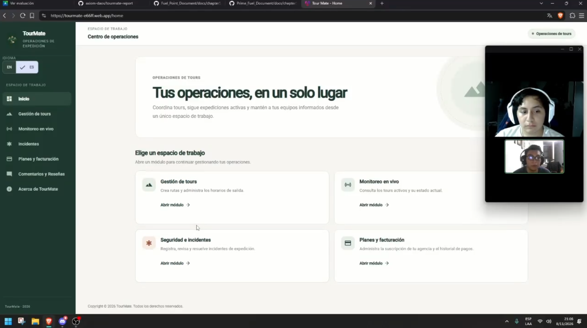
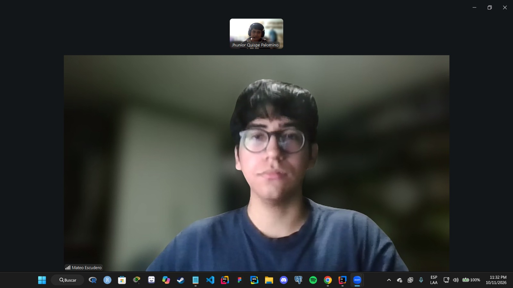
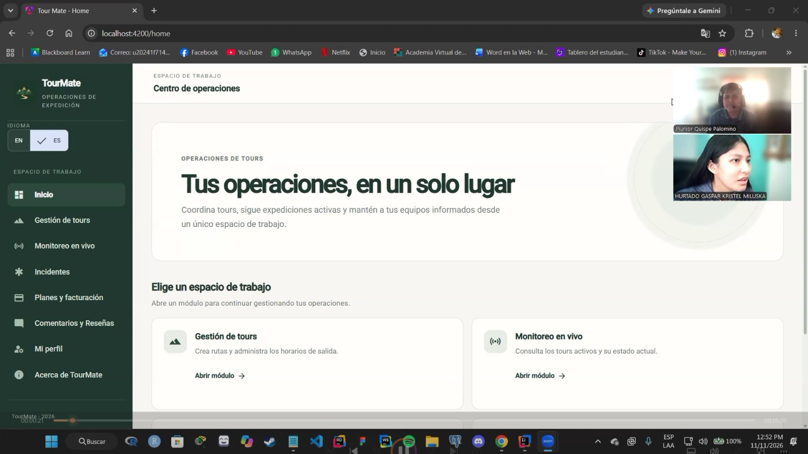
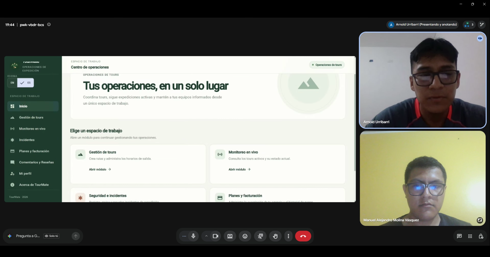
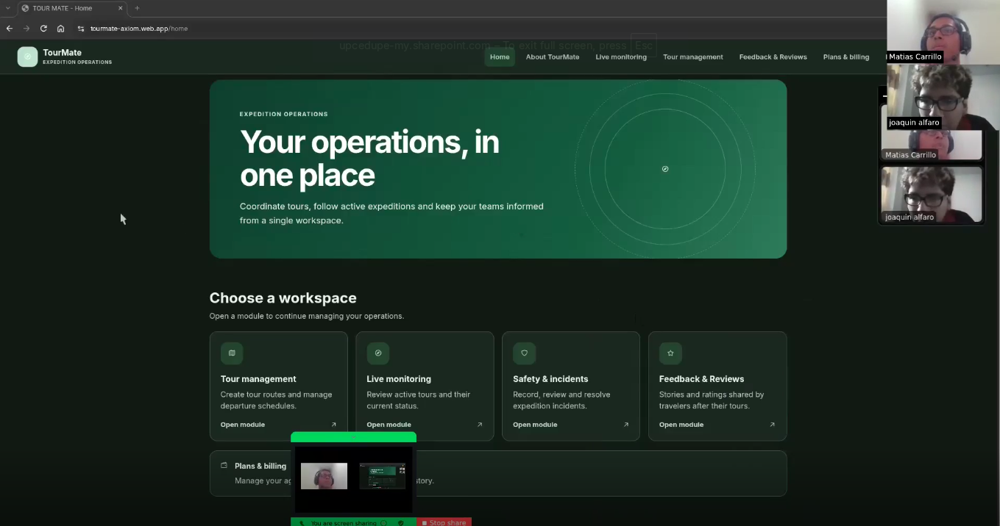
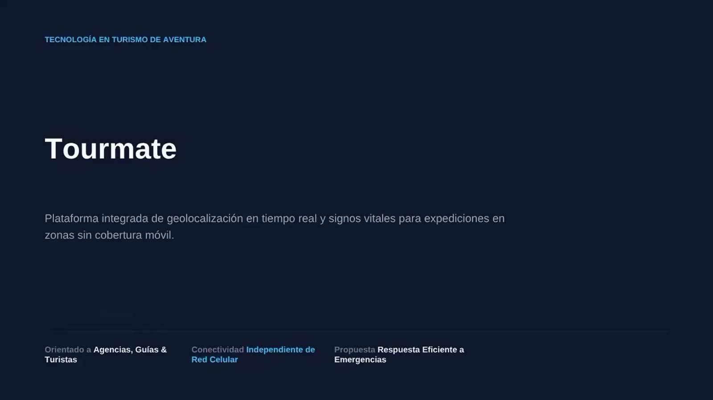
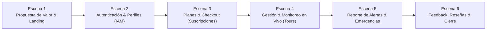

### 5.3. Validation Interviews

#### 5.3.1. Diseño de Entrevistas

Las entrevistas de validación constituyen la principal técnica de investigación cualitativa para evaluar la propuesta de valor, la utilidad práctica y la experiencia de uso de TourMate en un escenario real. A diferencia de la etapa de descubrimiento inicial, estas entrevistas se centran en interactuar con los usuarios finales tras su aproximación o uso simulado de la aplicación, obteniendo perspectivas críticas que alimentan el reporte técnico.

---

##### Objetivos Generales del Proceso de Entrevistas

1. Validar la efectividad del monitoreo y la respuesta a incidentes: Evaluar si el sistema de alertas tempranas, el seguimiento de ubicación y la telemetría IoT responden adecuadamente a las necesidades reales de seguridad en zonas de baja conectividad.
2. Medir la usabilidad y la experiencia offline: Comprobar la facilidad de uso de la aplicación móvil (para turistas y guías) y el panel web centralizado (para agencias) bajo condiciones de operación sin conexión continua.
3. Analizar la percepción de valor y disposición de adopción: Determinar el impacto del uso de dispositivos wearables y checkpoints Bluetooth (BLE) en la confianza del turista y en la eficiencia operativa de la agencia.
4. Identificar fricciones y oportunidades de mejora: Recoger feedback directo sobre flujos específicos (creación de tours, asignación de equipos, reporte de incidentes y sincronización asincrónica) para enriquecer las conclusiones del reporte final.

---

##### Segmento 1: Dueños o Responsables de Agencias de Turismo de Aventura

**Perfil del entrevistado:** Propietarios, gerentes de operaciones, administradores o guías principales de agencias que operan rutas de trekking, montañismo o turismo de aventura en zonas de baja conectividad del Perú.

---

**Apertura y Contexto Operativo**

1. ¿Cómo ha venido manejando la coordinación y supervisión de sus grupos en expediciones recientes en comparación con sus métodos tradicionales?
2. Tras conocer el funcionamiento del dashboard centralizado y los reportes de TourMate, ¿qué tan alineada se encuentra esta herramienta con la realidad operativa de su agencia?

**Validación del Monitoreo y Gestión de Incidentes**

3. Durante la simulación o uso del panel de control en vivo, ¿la visualización de la ubicación de los grupos y el estado de los checkpoints BLE le otorga la claridad necesaria para prevenir situaciones de riesgo?
4. ¿Cómo evalúa el sistema de alertas automáticas ante anomalías (desvíos de ruta o signos vitales fuera de rango)? ¿Considera que agiliza la toma de decisiones frente a los métodos convencionales?

**Funcionalidad Offline y Sincronización Asincrónica**

5. Teniendo en cuenta las zonas sin señal celular en las rutas peruanas, ¿qué tan útil le resulta el mecanismo de sincronización asincrónica para asegurar la trazabilidad de los datos al retornar la conectividad?
6. ¿Encontró alguna limitación o complejidad técnica al registrar o auditar el avance de las expediciones desde la plataforma?

**Adopción, Costos y Expectativas de Negocio**

7. ¿Considera que el modelo de suscripción SaaS combinado con la infraestructura de hardware se ajusta al presupuesto y capacidad de inversión de una Mypeta turística en el Perú?
8. ¿Qué funcionalidades considera que son absolutamente indispensables desde el primer día de implementación en campo y cuáles podrían incorporarse en fases posteriores?

**Gestión de Catálogo y Planificación de Tours**

9. Al momento de crear un nuevo tour y configurar sus checkpoints Bluetooth (BLE), ¿qué tan intuitivo le parece definir las rutas y asociar a los guías líderes?
10. ¿Qué dificultades encuentra actualmente al momento de realizar la asignación de pasajeros, gestionar la nómina oficial y entregar los equipos antes de que los grupos inicien el recorrido?
11. ¿Cómo le beneficia contar con un historial de rutas pasadas para estructurar nuevos itinerarios o planificar el mantenimiento preventivo de la logística?

---

##### Segmento 2: Turistas de Aventura

**Perfil del entrevistado:** Personas nacionales o extranjeras que hayan realizado o participado en actividades de turismo de aventura en zonas remotas de los Andes o la selva peruana en los últimos años.

---

**Apertura y Experiencia con la Aplicación**

1. ¿Con qué frecuencia realiza viajes de aventura o trekking y cuáles son los principales desafíos o temores a los que se enfrenta al recorrer zonas aisladas?
2. ¿Cómo calificaría su experiencia al utilizar la aplicación móvil de TourMate durante la navegación de la ruta y el registro de su recorrido?
3. En comparación con aplicaciones de mapas genéricas, ¿qué tan útil le pareció contar con mapas offline y la visualización de los checkpoints del tour?

**Seguridad, Privacidad y Uso de Dispositivos Wearables**

4. Si la agencia le proporciona un dispositivo wearable para el monitoreo pasivo de su ubicación y signos vitales durante el viaje, ¿generó esto mayor tranquilidad y confianza en su seguridad personal?
5. ¿Le causó alguna preocupación respecto a su privacidad el hecho de que sus datos de salud y ubicación fueran monitoreados temporalmente durante la expedición? ¿Qué condiciones le harían sentir más seguro al respecto?
6. ¿Qué dudas o reparos tendría antes de colocarse un dispositivo de monitoreo biométrico provisto por la agencia al iniciar una expedición exigente?
7. En caso de sufrir una emergencia o extraviarse, ¿qué tan cómodo se sentiría utilizando un botón de pánico físico o digital integrado en la aplicación móvil?

**Funcionalidades de Experiencia y Contexto**

8. ¿Qué tan valioso considera el acceso a información contextual (clima, datos históricos de la ruta, puntos de interés) y el resumen digital automático (diario de viaje con fotos y estadísticas) al finalizar el recorrido?
9. ¿Influyó positivamente el uso de esta tecnología en su decisión de elegir una agencia de turismo frente a otras alternativas tradicionales del mercado?
10. ¿Cómo califica la utilidad de recibir alertas tempranas o notificaciones sobre cambios climáticos repentinos o advertencias de terreno durante la caminata?
11. ¿Qué opina sobre la generación automática de un diario de viaje digital al finalizar la expedición para compartirlo con familiares o amigos?

---

##### Consideraciones Metodológicas

**Cantidad de entrevistas:** mínimo 3 y máximo 5 entrevistas por segmento (total: entre 6 y 10 entrevistas) para alcanzar saturación temática en una etapa de descubrimiento.

**Registro:** Las entrevistas deben ser grabadas con consentimiento del entrevistado para su posterior análisis. Se recomienda el uso de una guía de toma de notas que permita capturar citas textuales relevantes.

**Análisis:** Los resultados serán procesados mediante agrupamiento de respuestas por temática, identificando patrones comunes, necesidades no cubiertas y citas representativas para validar o refutar las hipótesis de problema y solución.

**Ética:** Antes de cada entrevista se informará al participante sobre el propósito de la investigación, la confidencialidad de sus respuestas y su derecho a retirarse en cualquier momento. No se recopilará información personal identificable más allá de la necesaria para el reclutamiento.

---

#### 5.3.2. Registro de Entrevistas

En esta sección se documentan las entrevistas de validación realizadas a los usuarios objetivo de ambos segmentos tras interactuar con la plataforma TourMate. Cada registro incluye los datos del participante, la evidencia audiovisual de la sesión y una síntesis estructurada del feedback cualitativo recibido sobre la funcionalidad, usabilidad y valor de la solución.

##### Segmento 1: Dueños o Responsables de Agencias de Turismo de Aventura

**Entrevista de Validación 1:**

| | |
| :--- | :--- |
| **Entrevistador:** | Frank Anthony Huingo Tello |
| **Entrevistado:** | Carlos Gutierrez |
| **Cargo / Agencia:** | Responsable operativo de Agencia de Turismo de Aventura (Trekking y Montañismo) |
| **Edad:** | 20 años |
| **Segmento:** | Dueño o responsable de agencia de turismo de aventura |
| **Fecha:** | 08/11/2026 |
| **Inicio de la entrevista:** | 0:00 |
| **Duración:** | 9:07 min |
| **Enlace:** | https://upcedupe-my.sharepoint.com/:v:/g/personal/u202319057_upc_edu_pe/IQCKEmttzH5dQry3cq63kqcnAYH04uQeaWWmC9FCgY6ubTc?nav=eyJyZWZlcnJhbEluZm8iOnsicmVmZXJyYWxBcHAiOiJPbmVEcml2ZUZvckJ1c2luZXNzIiwicmVmZXJyYWxBcHBQbGF0Zm9ybSI6IldlYiIsInJlZmVycmFsTW9kZSI6InZpZXciLCJyZWZlcnJhbFZpZXciOiJNeUZpbGVzTGlua0NvcHkifX0&e=HrRfsH |

**Resumen:** En esta sesión de validación, Carlos Gutiérrez (20 años), responsable de operaciones en rutas de trekking y alta montaña en el sur del país, interactuó con la versión funcional de la plataforma TourMate para evaluar su aplicabilidad en escenarios reales. Durante la prueba, navegó por el panel de administración de la agencia, validando el flujo de creación y configuración de paquetes turísticos, la asignación de cupos y fechas de salida programadas, y el módulo de visualización de expediciones activas. Carlos destacó positivamente la centralización de la información operativa en un único dashboard, señalando que reduce drásticamente los tiempos muertos frente a su método tradicional de bitácoras físicas y reportes dispersos por radio VHF. Asimismo, valoró la claridad en la visualización de rutas mediante waypoints y la estructura transparente de los planes de suscripción para agencias. En cuanto a oportunidades de mejora, recomendó incorporar alertas visuales más inmediatas al guardar cambios en los tours y permitir la duplicación rápida de expediciones frecuentes para optimizar el flujo de trabajo diario. Concluyó confirmando su alta disposición de adopción de la herramienta, resaltando que brindará mayor certidumbre y control sobre los grupos en campo.

---

**Entrevista de Validación 2:**

| | |
| :--- | :--- |
| **Entrevistador:** | Tony Jhunior Quispe Palomino |
| **Entrevistado:** | Mateo Escudero |
| **Cargo / Agencia:** | Guía y responsable de expediciones en Adventure Perú (Trekking, Montañismo y Turismo de Aventura) |
| **Edad:** | 22 años |
| **Segmento:** | Dueño o responsable de agencia de turismo de aventura |
| **Fecha:** | 10/11/2026 |
| **Inicio de la entrevista:** | 0:00 |
| **Duración:** | 16 min |
| **Enlace:** | https://upcedupe-my.sharepoint.com/:v:/g/personal/u20241f714_upc_edu_pe/IQCaP2RPTVfcS6Xf_WfVFIOHAQRGU5mXHN-oZEgRdLmhF5A?e=bjfHIv&nav=eyJyZWZlcnJhbEluZm8iOnsicmVmZXJyYWxBcHAiOiJTdHJlYW1XZWJBcHAiLCJyZWZlcnJhbFZpZXciOiJTaGFyZURpYWxvZy1MaW5rIiwicmVmZXJyYWxBcHBQbGF0Zm9ybSI6IldlYiIsInJlZmVycmFsTW9kZSI6InZpZXcifX0%3D |

**Resumen:** En esta segunda entrevista de validación se presentó la plataforma TourMate a Mateo Escudero, de 22 años, guía y responsable de expediciones en Adventure Perú, quien previamente había identificado dificultades para coordinar grupos turísticos en zonas de conectividad limitada. La sesión estuvo orientada a evaluar las funcionalidades de la aplicación web, incluyendo la gestión y planificación de tours, programación de horarios, supervisión de expediciones activas, visualización de rutas y checkpoints, administración de participantes, registro de incidentes, planes de suscripción y gestión de comentarios y reseñas. La validación se centró en determinar si la centralización de la información permitiría mejorar la coordinación operativa frente al uso tradicional de radios, WhatsApp y hojas de cálculo. Asimismo, se abordó la utilidad de los mecanismos de seguridad, las alertas y la sincronización de registros sin conexión, considerando las condiciones de las rutas de montaña donde opera su agencia. Finalmente, se consultó sobre la facilidad de uso de la plataforma, las funcionalidades prioritarias para una implementación real y la viabilidad de un modelo de suscripción mensual, tomando como referencia el presupuesto de S/100 a S/150 mencionado en la primera entrevista. Estos aspectos permiten orientar la identificación de oportunidades de mejora y evaluar la adecuación de TourMate a las necesidades de las agencias de turismo de aventura.

---

**Entrevista de Validación 3:**

| | |
| :--- | :--- |
| **Entrevistador:** | Manuel Alejandro Molina Vásquez |
| **Entrevistado:** | Sebastián Rojas |
| **Cargo / Agencia:** | Manager de una agencia de turismo. |
| **Edad:** | 29 años |
| **Segmento:** | Dueño o responsable de agencia de turismo de aventura |
| **Fecha:** | 08/11/2026 |
| **Inicio de la entrevista:** | 0:00 |
| **Duración:** | 11:55 min |
| **Enlace:** | https://upcedupe-my.sharepoint.com/:v:/g/personal/u20221g231_upc_edu_pe/IQDiXpUGhKUlRYlM5PIDGRelAaj4EeGX2tt505uHNBNHIQ0?nav=eyJyZWZlcnJhbEluZm8iOnsicmVmZXJyYWxBcHAiOiJPbmVEcml2ZUZvckJ1c2luZXNzIiwicmVmZXJyYWxBcHBQbGF0Zm9ybSI6IldlYiIsInJlZmVycmFsTW9kZSI6InZpZXciLCJyZWZlcnJhbFZpZXciOiJNeUZpbGVzTGlua0NvcHkifX0&e=LKK1Jz |

**Resumen:** En esta tercera entrevista, Sebastián Rojas, un manager de una agencia de turismo de 29 años, señala que la aplicación TourMate optimiza notablemente la gestión y el monitoreo en vivo de las expediciones frente a los métodos tradicionales, logrando una alineación operativa de entre el 90 y el 100 por ciento al facilitar eventos personalizados, planes de facturación y el control detallado de los puntos de control o checkpoints para garantizar la seguridad de los usuarios. Asimismo, destaca que el sistema de alertas automáticas, calificado con un sólido 9 sobre 10, y la sincronización asincrónica funcionan de manera excelente ante la falta de señal en las rutas peruanas, mientras que el modelo de suscripción se adapta de forma muy adecuada al presupuesto y capacidad de intervención de una MYPE turística local. Finalmente, considera como funcionalidades indispensables desde el primer día la gestión y el monitoreo en tiempo real de los tours, dejando las reseñas y comentarios para fases posteriores, y valora muy positivamente el uso del historial de rutas pasadas para estructurar itinerarios más eficientes que optimicen el tiempo limitado de los clientes..

---

##### Segmento 2: Turistas de Aventura

**Entrevista de Validación 4:**

| | |
| :--- | :--- |
| **Entrevistador:** | Tony Jhunior Quispe Palomino |
| **Entrevistado:** | Kristel Miluska Hurtado Gaspar |
| **Edad:** | 23 años |
| **Segmento:** | Turistas de Aventura |
| **Fecha:** | 11/11/2026 |
| **Inicio de la entrevista:** | 0:00 |
| **Duración:** | 16:26 min |
| **Enlace:** | https://upcedupe-my.sharepoint.com/:v:/g/personal/u20241f714_upc_edu_pe/IQDsQqslkcl0TKivHfx5khsWAXnladEhIC5YmP03iaH2okM?e=fQr6pu&nav=eyJyZWZlcnJhbEluZm8iOnsicmVmZXJyYWxBcHAiOiJTdHJlYW1XZWJBcHAiLCJyZWZlcnJhbFZpZXciOiJTaGFyZURpYWxvZy1MaW5rIiwicmVmZXJyYWxBcHBQbGF0Zm9ybSI6IldlYiIsInJlZmVycmFsTW9kZSI6InZpZXcifX0%3D |

**Resumen:**

La entrevista de validación se realizó a Kristel Miluska Hurtado Gaspar, de aproximadamente 23 años y procedente del Callao, perteneciente al segmento de Turistas de Aventura. Durante la sesión se presentó el frontend de la aplicación web TourMate, desarrollado por el equipo Axiom, con el propósito de evaluar la propuesta tecnológica desde la perspectiva de los turistas. Se mostraron las principales funcionalidades de la plataforma, incluyendo el catálogo y la gestión de tours, la programación de salidas, el monitoreo de expediciones, la visualización de rutas y checkpoints, el registro de incidentes, las reseñas de los usuarios y los perfiles. Posteriormente, se abordaron aspectos relacionados con la facilidad de uso, la claridad de la información y la utilidad del seguimiento durante las actividades de aventura. Asimismo, se exploró la percepción sobre las funcionalidades propuestas, como los mapas sin conexión a internet, el monitoreo mediante dispositivos wearables, las alertas de seguridad, el botón de emergencia y la generación de un diario digital del recorrido. La validación permitió abordar aspectos importantes para el segmento, como la seguridad del turista, la privacidad de sus datos personales, la facilidad de acceso a las funciones de emergencia y la importancia de contar con información confiable sobre las rutas. Estos criterios servirán como referencia para evaluar posibles mejoras en la interfaz, la experiencia del usuario y las funcionalidades de seguridad de TourMate.

---

**Entrevista de Validación 5:**

| | |
| :--- | :--- |
| **Entrevistador:** | Manuel Alejandro Molina Vásquez |
| **Entrevistado:** | Kevyn Huerta |
| **Edad:** | 22 años |
| **Segmento:** | Turista de Aventura |
| **Fecha:** | 08/11/2026 |
| **Inicio de la entrevista:** | 0:00 |
| **Duración:** | 10:00 min |
| **Enlace:** | https://upcedupe-my.sharepoint.com/:v:/g/personal/u20221g231_upc_edu_pe/IQAG25-_TphrT5U-4sAxeMWXAdn-ONSl-8y605TanyfME5E?nav=eyJyZWZlcnJhbEluZm8iOnsicmVmZXJyYWxBcHAiOiJPbmVEcml2ZUZvckJ1c2luZXNzIiwicmVmZXJyYWxBcHBQbGF0Zm9ybSI6IldlYiIsInJlZmVycmFsTW9kZSI6InZpZXciLCJyZWZlcnJhbFZpZXciOiJNeUZpbGVzTGlua0NvcHkifX0&e=qB9log |

**Resumen:** En esta cuarta entrevista, Kevyn Huerta, un estudiante de 22 años que practica trekking vacacionalmente, señala que la aplicación TourMate ofrece funciones muy interesantes y especializadas para esta actividad frente a los mapas convencionales, destacando la utilidad de los mapas sin conexión y la visualización de puntos seguros para una mejor orientación. Asimismo, valora positivamente el monitoreo de salud y ubicación mediante dispositivos provistos por la agencia para ganar tranquilidad, no muestra preocupaciones respecto a la privacidad de sus datos debido a la utilidad práctica de estos, y resalta que el botón de pánico es una herramienta clave para obtener una ubicación exacta y optimizar los tiempos de rescate ante emergencias. Igualmente, considera muy valioso el resumen digital automático al finalizar el recorrido para evaluar el desempeño físico, afirma que esta tecnología influye positivamente en la decisión de elegir una agencia de turismo, destaca la importancia de recibir alertas meteorológicas y advertencias de terreno en tiempo real para prevenir riesgos, y opina que la generación automática de un diario de viaje digital es excelente tanto para conservar recuerdos y compartir la experiencia con familiares como para planificar mejor futuras expediciones..

---

**Entrevista de Validación 6:**

| | |
| :--- | :--- |
| **Entrevistador:** | Matias Carrillo |
| **Entrevistado:** | Joaquin Alfaro |
| **Edad:** | 19 años |
| **Segmento:** | Turista de Aventura |
| **Fecha:** | 13/11/2026 |
| **Inicio de la entrevista:** | 0:00 |
| **Duración:** | 05:48 min |
| **Enlace:** | https://upcedupe-my.sharepoint.com/:v:/g/personal/u202323010_upc_edu_pe/IQDY3y5zX4lmQ7x5E_PkZPgAAY8PAidzblAtgLGLS5oHbG4?nav=eyJyZWZlcnJhbEluZm8iOnsicmVmZXJyYWxBcHAiOiJTdHJlYW1XZWJBcHAiLCJyZWZlcnJhbFZpZXciOiJTaGFyZURpYWxvZy1MaW5rIiwicmVmZXJyYWxBcHBQbGF0Zm9ybSI6IldlYiIsInJlZmVycmFsTW9kZSI6InZpZXcifX0%3D&e=j4u4Zx |

**Resumen:** Joaquín hace trekking unas 4 o 5 veces al año en zonas remotas y lo que más le preocupa es perder la señal, desorientarse o tener un accidente lejos de ayuda. Le encantó la app de TourMate: la navegación es clara, el recorrido se registra solo y los mapas offline y los checkpoints le parecieron mucho mejores que un mapa genérico, aunque pidió que gaste menos batería. El wearable lo hizo sentir respaldado, pero le preocupa un poco la privacidad, así que quiere saber qué datos se recogen, quién los ve y cuándo se borran. También le inquieta que el dispositivo sea cómodo, aguante frío y lluvia, y qué pasa si hay una falsa alarma. El botón de pánico le parece buena idea mientras funcione con poca señal y pida confirmación. Las alertas de clima y la info de la ruta le parecieron muy útiles, y entre dos agencias elegiría la que tenga este tipo de tecnología. El diario de viaje automático le gustó, pero quiere poder editarlo antes de compartirlo.

---

#### 5.3.3. Evaluaciones según heurísticas

A partir de las sesiones de interacción y entrevistas de validación realizadas con los usuarios de ambos segmentos (agencias y turistas), se llevó a cabo una **evaluación heurística consolidada** basada en los diez principios generales para el diseño de interfaces de usuario propuestos por **Jakob Nielsen**.

Para priorizar las oportunidades de mejora encontradas, se empleó la escala estándar de severidad de Nielsen:
- **0 - Sin problema:** No se considera un problema de usabilidad.
- **1 - Problema cosmético:** No interfiere en la tarea; solo se corrige si sobra tiempo.
- **2 - Problema menor:** Dificultad leve de uso; baja prioridad de resolución.
- **3 - Problema mayor:** Dificultad importante; afecta la experiencia y debe corregirse con alta prioridad.
- **4 - Catástrofe de usabilidad:** Impide al usuario completar la tarea esencial; resolución imperativa.

---

##### Matriz Consolidada de Evaluación Heurística (TourMate Web Application)

| N° | Principio Heurístico de Nielsen | Problema / Hallazgo Detectado en la Validación | Severidad | Propuesta de Solución / Mejora de Diseño |
|:---:|:---|:---|:---:|:---|
| **1** | **Visibilidad del estado del sistema** | Al guardar o editar un tour, el usuario no recibía confirmación visual inmediata del procesamiento ni del guardado exitoso en el backend. | **2** | Implementar notificaciones tipo *snackbar* / *toast* reactivas y *spinners* de carga durante las peticiones asíncronas HTTP. |
| **2** | **Coincidencia entre el sistema y el mundo real** | Algunos términos técnicos en la vista de monitoreo de expedición resultaban poco familiares para los guías y turistas. | **1** | Adecuar la terminología hacia el lenguaje ubicuo del turismo de aventura (ej. reemplazar *lat/lng payload* por *Punto de Control*, *Waypoints* y *Altitud*). |
| **3** | **Control y libertad del usuario** | En el formulario de creación de tours no existía una opción clara para cancelar o descartar los cambios sin tener que recargar el navegador. | **3** | Agregar un botón explícito de *"Cancelar / Descartar"* con modal de confirmación para evitar pérdida accidental de datos. |
| **4** | **Consistencia y estándares** | El botón de acción principal (*CTA*) presentaba variaciones de color y posición entre la vista del catálogo y la vista de detalle del tour. | **2** | Estandarizar la jerarquía visual de botones con los tokens de diseño definidos en la guía de estilos de Angular Material. |
| **5** | **Prevención de errores** | En los campos de capacidad de turistas y precio por persona se permitían valores negativos o caracteres no numéricos antes de enviar el formulario. | **3** | Incorporar validadores reactivos en tiempo real (`Validators.min`, `Validators.pattern`) que deshabiliten el botón de envío ante entradas no válidas. |
| **6** | **Reconocimiento antes que recuerdo** | Para asignar guías a un tour, el administrador debía recordar y escribir el identificador manualmente en lugar de seleccionarlo. | **3** | Reemplazar el campo de texto libre por un componente de selección desplegable (`mat-select`) con búsqueda predictiva y avatares de guías disponibles. |
| **7** | **Flexibilidad y eficiencia de uso** | Usuarios recurrentes de agencias solicitaron atajos o una opción de duplicar tours existentes para no llenar todos los campos desde cero. | **2** | Añadir la acción de *"Clonar / Duplicar Tour"* en la tabla de gestión de tours para agilizar la creación de expediciones similares. |
| **8** | **Estética y diseño minimalista** | La tarjeta de resumen del tour contenía exceso de texto secundario que dificultaba escanear rápidamente la información clave (precio, duración, dificultad). | **2** | Rediseñar las tarjetas aplicando arquitectura de información limpia con *badges* destacados para dificultad, duración y precio. |
| **9** | **Ayudar a reconocer, diagnosticar y recuperarse de errores** | Los mensajes de error de la API mostraban descripciones técnicas genéricas (ej. *Error 400 Bad Request*) sin explicar qué campo falló. | **3** | Interceptar respuestas HTTP de error en el frontend para mostrar mensajes amigables y contextuales (ej. *"La fecha de inicio debe ser posterior al día de hoy"*). |
| **10** | **Ayuda y documentación** | En el apartado de bitácoras y monitoreo de emergencias, los usuarios primerizos no tenían una guía introductoria sobre el significado de cada estado. | **1** | Incorporar tooltips informativos y un botón flotante de ayuda rápida con preguntas frecuentes sobre el funcionamiento del monitoreo. |

---

### 5.4. Video About-the-Product

El video *About-the-Product* constituye el artefacto audiovisual de validación demostrativa de la plataforma TourMate. Su objetivo principal es exponer el valor de negocio, la interacción de los usuarios y la operatividad técnica de los servicios implementados a lo largo de los tres Sprints de desarrollo, integrando el frontend en Angular con los servicios backend RESTful en Spring Boot.

#### Ficha Técnica del Video de Producto

| Parámetro | Detalle |
| :--- | :--- |
| **Título del Video:** | TourMate - Plataforma Web para Gestión y Monitoreo Seguro de Turismo de Aventura |
| **Duración:** | 4:30 min |
| **Fecha de Producción:** | Noviembre 2026 |
| **Plataforma / Enlace:** | [TourMate – About the Product (OneDrive)](https://upcedupe-my.sharepoint.com/:v:/g/personal/u202323010_upc_edu_pe/IQAPtJVrqwuGTZCCC9fHlhMBARrVqF87HanSRUyzDOXRLus?nav=eyJyZWZlcnJhbEluZm8iOnsicmVmZXJyYWxBcHAiOiJTdHJlYW1XZWJBcHAiLCJyZWZlcnJhbFZpZXciOiJTaGFyZURpYWxvZy1MaW5rIiwicmVmZXJyYWxBcHBQbGF0Zm9ybSI6IldlYiIsInJlZmVycmFsTW9kZSI6InZpZXcifX0%3D&e=IhZXfd) |
| **Presentadores / Miembros:** | Frank Anthony Huingo Tello, Matias Renato Carrillo Acho, Giancarlo Jose Verastigue Martinez, Manuel Alejandro Molina Vasquez, Tony Jhunior Quispe Palomino |

*Figura 5.31. Captura representativa del video de demostración About the Product.*

---

#### Estructura y Guion de Escenas del Video

1. **Escena 1: Presentación y Propuesta de Valor (0:00 - 0:45)**  
   Demostración de la *Landing Page* institucional de TourMate, explicando la problemática de seguridad y coordinación que enfrentan las agencias de turismo de aventura y los turistas en rutas de trekking sin señal celular continua.
2. **Escena 2: Autenticación y Gestión de Identidad (0:45 - 1:30)**  
   Demostración del flujo de inicio de sesión (*Sign-in*) y registro (*Sign-up*) con asignación de roles de usuario (Agencia, Guía, Turista, Administrador) y emisión de credenciales seguras mediante tokens JWT en Spring Boot.
3. **Escena 3: Catálogo de Planes y Checkout Interactivo (1:30 - 2:30)**  
   Visualización interactiva del catálogo de planes de suscripción para operadores turísticos, comparación de funcionalidades por nivel (básico, profesional, empresarial), simulación de pasarela de pago segura y emisión automática del comprobante de recibo fiscal digital con opción de impresión.
4. **Escena 4: Creación de Tours y Monitoreo de Expedición en Vivo (2:30 - 3:45)**  
   Recorrido por la creación y programación de tours, asignación de guías de campo y visualización en tiempo real del mapa de expedición con telemetría de ubicación y checkpoints georreferenciados.
5. **Escena 5: Bitácora de Seguridad y Reporte de Incidentes (3:45 - 4:30)**  
   Simulación de una alerta de emergencia reportada desde la expedición, visualización en el dashboard de control de la agencia con coordenadas exactas, nivel de severidad y registro de resolución de incidentes.
6. **Escena 6: Calificaciones, Reseñas Turísticas y Cierre (4:30 - Conclusión)**  
   Registro y consulta de reseñas turísticas por parte de los participantes tras culminar el recorrido, demostrando la integración completa y la robustez de los servicios desarrollados en el ciclo de vida del proyecto.
